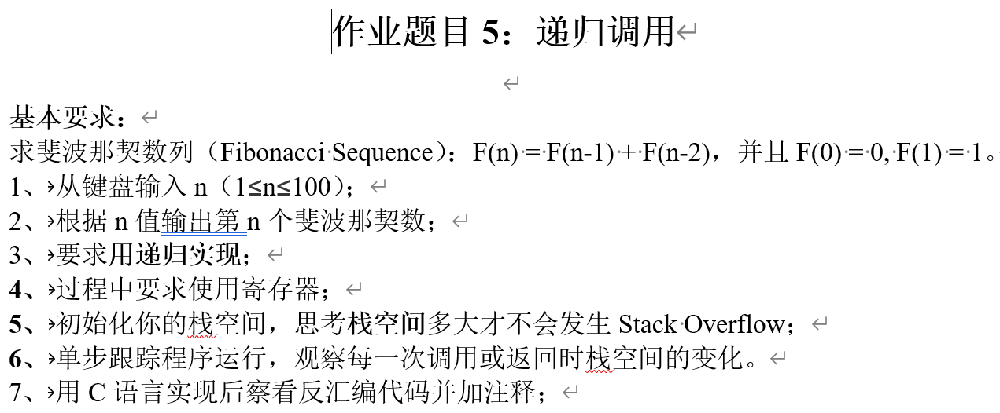
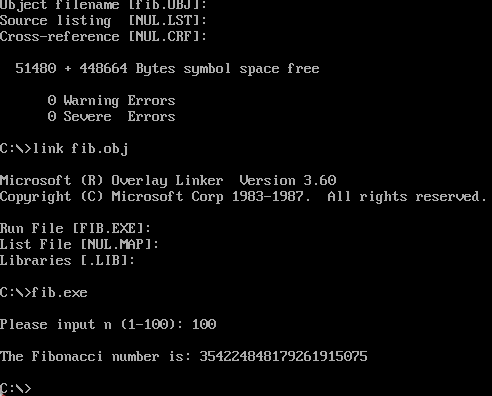

图片中的文字内容如下：

**作业题目 5：递归调用**

**基本要求：**
求斐波那契数列（Fibonacci Sequence）：F(n)=F(n-1)+F(n-2)，并且 F(0)=0, F(1)=1。
1、从键盘输入 n（1≤n≤100）；
2、根据 n 值输出第 n 个斐波那契数；
3、要求用递归实现；
4、过程中要求使用寄存器；
5、初始化你的栈空间，思考栈空间多大才不会发生 Stack Overflow；
6、单步跟踪程序运行，观察每一次调用或返回时栈空间的变化。
7、用 C 语言实现后查看反汇编代码并加注释；

对应文件：

- `fib.asm`：递归实现，支持 n 在 1~100 范围内并正确输出大数结果
- `fib.c`：C 语言递归实现，作为对照参考（朴素递归，`long long` 到 F(92)，大 n 运行很慢）
- 运行结果：

实现说明：

- 递归出口为 F(0)=0、F(1)=1，其余按 F(n)=F(n-1)+F(n-2) 逐层调用与返回
- 结果按十进制逐位存放在数据段（低位在前），因此 F(100) 的 21 位结果也能正确输出
- 用 `FIB_LEN[n]` 是否为 0 作为“已计算”标记，避免朴素递归的指数级重复计算
- 栈空间取 `.stack 1000h`（4KB）：每层约 16 字节，100 层约 1.6KB，再留出中断使用的余量，不会 Stack Overflow