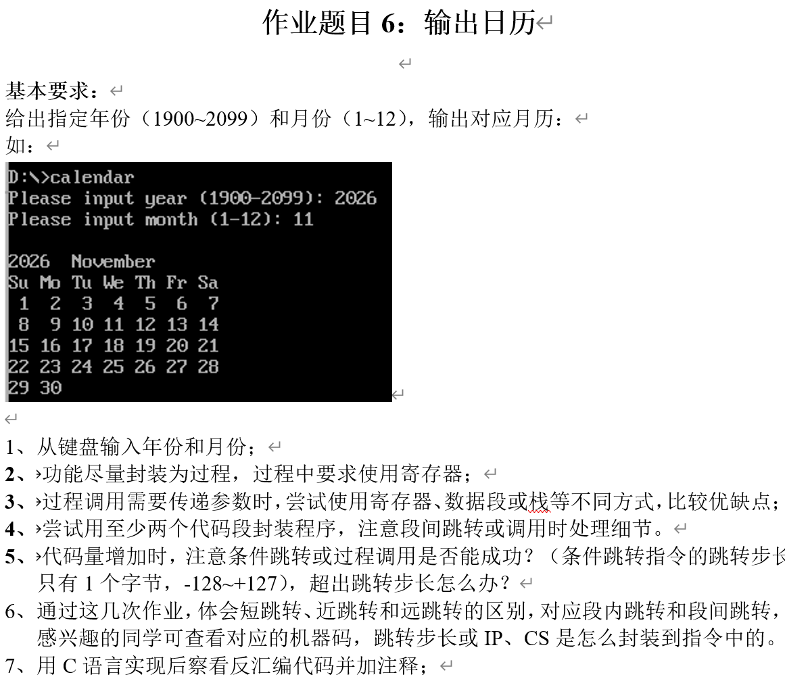

图片中的文字内容如下：

**作业题目 6：输出日历**

基本要求：
给出指定年份（1900 ~ 2099）和月份（1~12），输出对应月历：
如：
```text
D:\>calendar
Please input year (1900-2099): 2026
Please input month (1-12): 11

2026  November
Su Mo Tu We Th Fr Sa
 1  2  3  4  5  6  7
 8  9 10 11 12 13 14
15 16 17 18 19 20 21
22 23 24 25 26 27 28
29 30
```

1、从键盘输入年份和月份；
2、功能尽量封装为过程，过程中要求使用寄存器；
3、过程调用需要传递参数时，尝试使用寄存器、数据段或栈等不同方式，比较优缺点；
4、尝试用至少两个代码段封装程序，注意段间跳转或调用时处理细节。
5、代码量增加时，注意条件跳转或过程调用是否能成功？（条件跳转指令的跳转步长只有 1 个字节，-128~+127），超出跳转步长怎么办？
6、通过这几次作业，体会短跳转、近跳转和远跳转的区别，对应段内跳转和段间跳转，感兴趣的同学可查看对应的机器码，跳转步长或 IP、CS 是怎么封装到指令中的。
7、用 C 语言实现后察看反汇编代码并加注释；

对应文件：

- `calendar.asm`：8086 汇编实现，两个代码段（功能过程段 + 主程序段），段间用 `CALL FAR` 调用
- `calendar.c`：C 语言对照实现，算法与汇编版一一对应
- `report.md`：实现过程中的困难、挫折与纠正记录

运行输出（输入 2026 年 11 月）：

```text
Please input year (1900-2099): 2026
Please input month (1-12): 11

2026  November
Su Mo Tu We Th Fr Sa
 1  2  3  4  5  6  7
 8  9 10 11 12 13 14
15 16 17 18 19 20 21
22 23 24 25 26 27 28
29 30
```

实现说明：

- 求星期：以 1900-01-01 是星期一为基准，累计整年天数、中间闰年数、本月之前天数，最后对 7 取余
- 1900~2099 的累计天数最大 73018，超过 16 位寄存器的表示范围，因此每一步累加后立即对 7 取模
- 闰年判定：能被 4 整除且不是 1900（2000 能被 400 整除，按闰年处理）
- 每个日期格占 3 列（相当于 C 的 `"%2d "`），周六后换行；月初空位同样补 3 个空格
- 边界核对：1900-01 周一开头、2000-02 周二开头（29 天）、2024-02 周四开头（29 天）、2099-12 周二开头、非法输入提示 `Invalid input!`

程序结构（两个代码段）：

| 代码段 | 内容 |
| --- | --- |
| `CODESEG2` | 功能过程：`READ_NUM`、`PRINT_STR`、`PRINT_CHAR`、`PRINT_YEAR`、`PRINT_NUM2`、`CALC_MONTH_DAYS`、`CALC_FIRST_DAY`、`PRINT_CALENDAR` |
| `CODESEG1` | 主程序：`START` 入口，负责输入、校验并调用各功能过程 |

三种参数传递方式对照：

| 传参方式 | 本例中的过程 | 优点 | 缺点 |
| --- | --- | --- | --- |
| 寄存器 | `READ_NUM`（AX 返回）、`PRINT_NUM2`/`PRINT_YEAR`（AX 传入）、`PRINT_STR`（DX 传串地址）、`PRINT_CHAR`（DL 传字符） | 速度最快，不访问内存，代码短 | 寄存器数量有限，嵌套调用要保护现场，参数多时不够用 |
| 数据段 | `CALC_MONTH_DAYS`、`PRINT_CALENDAR`（读写全局 `YEAR`/`MONTH`/`DAYS`/`FIRST_DAY`） | 参数个数几乎不受限制，适合保存程序的全局状态 | 过程与全局变量耦合，可重入性差，接口不直观 |
| 堆栈 | `CALC_FIRST_DAY`（调用者 `PUSH` 年、月，过程内用 `[BP+8]`/`[BP+6]` 取参，`RET 4` 清参） | 支持嵌套调用，参数随调用生灭，最通用 | 需要 BP 寻址，访问比寄存器慢，要小心栈平衡 |

调用与跳转：

- 段间调用：`CALL FAR` 依次压入 CS、IP 共 4 字节，返回用 `RETF`。本例 `RET 4` 先弹出 4 字节返回地址，再清除 4 字节实参
- 正因返回地址是 4 字节，段间调用的栈参数偏移从 `[BP+6]` 开始（段内调用是 `[BP+4]`）
- 条件跳转位移只有 1 字节（-128~+127），代码变长后可能超出范围：可让 `Jcc` 跳到附近标签，再用 `JMP`（near，位移 16 位，段内任意距离）接力；`PRINT_CALENDAR` 末尾 `PC_END` 处保留了这一写法
- 跨段则必须用 `CALL FAR` / `JMP FAR`，对应段间跳转

编译与运行：

```dos
run.bat 6
masm calendar.asm;
link calendar.obj;
calendar
```

注意命令末尾的分号：

- `masm` 和 `link` 在文件名后会继续询问 `Object filename`、`Source listing`、`Run file` 等，分号表示这些提示全部取默认值
- 在 DOSBox 交互界面手动输入时，`masm calendar.asm` 后逐个回车确认也可以；但用 `-c` 参数或批处理调用时没有交互输入，必须写成 `masm calendar.asm;`，否则程序会停在 `Object filename:` 提示处，看起来像"编译成功"却没有生成 `.OBJ`
- 链接同理，写成 `link calendar.obj;`

