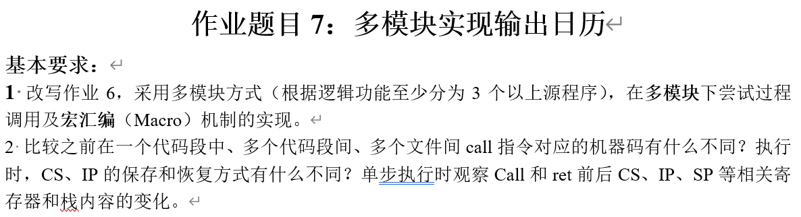

图片中的文字内容如下：

**作业题目 7：多模块实现输出日历**

**基本要求：**
1· 改写作业 6，采用多模块方式（根据逻辑功能至少分为 3 个以上源程序），在多模块下尝试过程调用及宏汇编（Macro）机制的实现。
2 比较之前在一个代码段中、多个代码段间、多个文件间 call 指令对应的机器码有什么不同？执行时，CS、IP 的保存和恢复方式有什么不同？单步执行时观察 Call 和 ret 前后 CS、IP、SP 等相关寄存器和栈内容的变化。

---

## 一、程序结构

按逻辑功能拆成 4 个源文件（每个文件各自拥有一个代码段），另加 1 个宏库：

| 文件 | 段名 | 导出（PUBLIC） | 引用的外部符号 | 职责 |
| --- | --- | --- | --- | --- |
| [main.asm](file:///d:/assembly_anguage_cpu/homework7/main.asm) | `CSEG_MAIN` | 全局数据 `YEAR`、`MONTH`、`DAYS`、`FIRST_DAY`、消息串、月名表、`DAY_TAB`、`ACC_TAB` | 5 个功能过程 | 定义 `STACKSG`/`DATASG`，输入、校验、组织调用 |
| [input.asm](file:///d:/assembly_anguage_cpu/homework7/input.asm) | `CSEG_IN` | `READ_NUM`、`PRINT_STR` | 无 | 键盘输入十进制数、输出 `$` 结尾字符串 |
| [calc.asm](file:///d:/assembly_anguage_cpu/homework7/calc.asm) | `CSEG_CALC` | `CALC_MONTH_DAYS`、`CALC_FIRST_DAY` | 数据段符号 | 当月天数、1 号星期几 |
| [print.asm](file:///d:/assembly_anguage_cpu/homework7/print.asm) | `CSEG_PRINT` | `PRINT_CALENDAR` | `PRINT_STR`、数据段符号 | 输出年份、日期、整张月历 |
| [macro.inc](file:///d:/assembly_anguage_cpu/homework7/macro.inc) | — | — | — | 宏库：`OUT_STR`、`NEWLINE`、`OUT_CHAR`、`CHECK_RANGE` |

链接后的段布局（`CALENDAR.MAP`）：

```text
 Start  Stop   Length Name       Class
 00000H 001FFH 00200H STACKSG    STACK
 00200H 002FFH 00100H DATASG     DATA
 00300H 00375H 00076H CSEG_MAIN  CODE
 00380H 003BCH 0003DH CSEG_IN    CODE
 003C0H 00463H 000A4H CSEG_CALC  CODE
 00470H 0056AH 000FBH CSEG_PRINT CODE
Program entry point at 0030:0000
```

因为每个模块的代码段互相独立，跨文件调用一律是**远调用**：引用方写 `EXTRN xxx:FAR`，定义方写 `PROC FAR` + `PUBLIC`。

参数传递方式仍保留三种（与作业 6 一致）：

- 寄存器：`READ_NUM`（AX 返回）、`PRINT_NUM2`（AX 传入）、`PRINT_STR`（DX 传串地址）
- 数据段：`CALC_MONTH_DAYS`、`PRINT_CALENDAR`（读写全局 `YEAR`/`MONTH`/`DAYS`/`FIRST_DAY`）
- 堆栈：`CALC_FIRST_DAY`（调用者先 `PUSH` 年、再 `PUSH` 月，过程内 `[BP+8]`/`[BP+6]` 取参，`RET 4` 清参）

## 二、宏汇编

[macro.inc](file:///d:/assembly_anguage_cpu/homework7/macro.inc) 里定义了 4 个宏，被 `main.asm` 与 `print.asm` 通过 `INCLUDE` 引用：

| 宏 | 展开为 | 用途 |
| --- | --- | --- |
| `OUT_STR addr` | `LEA DX,addr` + `CALL PRINT_STR` | 输出提示串/表头/换行 |
| `NEWLINE` | `LEA DX,CRLF` + `CALL PRINT_STR` | 换行 |
| `OUT_CHAR` | `MOV AH,02H` + `INT 21H` | 输出 DL 中的字符 |
| `CHECK_RANGE lo,hi,err` | 两次 `CMP` + `JB`/`JA` | 年份、月份范围校验 |

宏与过程的取舍：宏在汇编阶段就地展开，省掉 `CALL`/`RET` 的开销，但每引用一次就复制一份代码；过程只有一份代码，代价是调用开销。本例把"取偏移 + 调输出过程"这种固定套路做成宏，既缩短源码，又不重复写 `LEA/CALL` 两行。

列表文件里可以看到宏展开的行带了**嵌套层号 `1`**，例如：

```text
 0005  8D 16 0000 R          1          LEA     DX, MSG_YEAR
 0009  9A 0000 ---- E        1          CALL    PRINT_STR
 0013  3D 076C               1          CMP     AX, 1900
 0016  72 50                 1          JB      MAIN_ERR
```

层号 `1` 表示这行是宏展开产生的，不是手写指令。

## 三、编译与运行

```dos
run.bat 7
masm main.asm,main.obj,main.lst,nul
masm input.asm,input.obj,input.lst,nul
masm calc.asm,calc.obj,calc.lst,nul
masm print.asm,print.obj,print.lst,nul
link main+input+calc+print,calendar,calendar.map;
calendar
```

也可以直接运行仓库里的 [BUILD.BAT](file:///d:/assembly_anguage_cpu/homework7/BUILD.BAT)，一次完成 4 次汇编 + 1 次链接，并把日志写进各自的 `.LOG`。

注意：

- 每个模块单独汇编，`END` 后**不能带入口标号**（只有 `main.asm` 是 `END START`），入口在链接时由含 `END START` 的目标文件决定，`.MAP` 中的 `Program entry point at 0030:0000` 即为主模块代码段。
- `masm`、`link` 后面必须加分号（或把后续提示都写全），否则会停在 `Object filename:` 处等待输入。
- 交叉引用（一个模块调用另一个模块的过程）必须成对出现 `EXTRN xxx:FAR` 与 `PROC FAR` + `PUBLIC xxx`，否则链接时报 `unresolved external`。

汇编结果：4 个模块均 `0 Warning Errors / 0 Severe Errors`，链接无告警。

## 四、三种 CALL 的机器码对比

这是本次作业的核心。三种情况都实际编译出列表文件（`masm x.asm,x.obj,x.lst;`）取得真实机器码。

### 1）同一代码段内调用 —— 近调用（near）

`print.asm` 中 `PRINT_YEAR`、`PRINT_NUM2` 只被本模块的 `PRINT_CALENDAR` 调用，因此声明为 `PROC NEAR`，`CALL` 直接编译成 3 字节的段内近调用：

```text
 0061  E8 0000 R            CALL    PRINT_YEAR
 00C8  E8 002F R            CALL    PRINT_NUM2
```

- 机器码：`E8` + 16 位**段内相对位移**，共 3 字节
- 入栈：只压入返回的 **IP**（2 字节），CS 不变
- 返回：`RET`（`C3`）只弹出 IP
- 地址范围：±32K（位移是 16 位补码），不跨段

### 2）同一文件、不同代码段之间调用 —— 远调用（far）

作业 6 的 `calendar.asm` 是"一个文件、两个代码段"，`CODESEG1` 调用 `CODESEG2` 的 FAR 过程。对它重新汇编并生成列表文件（`masm calendar.asm,calendar.obj,calendar.lst;`）后可以看到：

```text
 0140  9A 0042 ---- R       CALL    PRINT_YEAR
 01AE  9A 0071 ---- R       CALL    PRINT_NUM2
 000E  9A 0000 ---- R       CALL    READ_NUM
```

- 机器码：`9A` + 16 位**偏移** + 16 位**段值**，共 5 字节
- 因为同在一个模块里，汇编器**知道目标在段内的偏移**（如 `0042`、`0071`），但段值要等装入内存才确定，所以段位置为 `----`，由链接器/装入器填写（`R` 表示需要重定位）
- 入栈：先压 **CS**，再压 **IP**，共 4 字节
- 返回：`RETF`（`CB`）依次弹出 IP、CS

### 3）不同文件（不同模块）之间调用 —— 远调用 + 外部符号

本作业 `main.asm` 调用 `input.asm`/`calc.asm`/`print.asm` 里的过程，汇编 `main.asm` 时目标根本不在本模块，所以偏移也是未知的：

```text
 0009  9A 0000 ---- E  1    CALL    PRINT_STR
 000E  9A 0000 ---- E       CALL    READ_NUM
 003B  9A 0000 ---- E       CALL    CALC_MONTH_DAYS
 004D  9A 0000 ---- E       CALL    CALC_FIRST_DAY
 005E  9A 0000 ---- E       CALL    PRINT_CALENDAR
```

- 机器码：同样是 `9A` + 偏移 + 段值，5 字节
- 区别在于**偏移也被填成 `0000`，并标 `E`（external）**：汇编阶段偏移和段值都不知道，全部留给链接器
- 入栈/返回方式与情况 2 相同：压 CS、IP 共 4 字节，`RETF` 返回

### 汇总对照

| 情况 | 示例 | 机器码 | 长度 | 入栈内容 | 返回指令 | 地址确定时机 |
| --- | --- | --- | --- | --- | --- | --- |
| 同一代码段内 | `print.asm` 调 `PRINT_YEAR` | `E8 xxxx` | 3 字节 | IP（2 字节） | `RET` | 汇编时（相对位移） |
| 同文件不同段 | `homework6` `CALL PRINT_YEAR` | `9A oooo ----` | 5 字节 | CS、IP（4 字节） | `RETF` | 偏移汇编时已知，段值链接/装入时填 |
| 不同文件 | `main.asm` 调 `PRINT_STR` | `9A 0000 ---- E` | 5 字节 | CS、IP（4 字节） | `RETF` | 偏移与段值都由链接器填写 |

由此可见：**跨段只改变"压不压 CS"，跨文件进一步把"偏移"也推迟到链接阶段**。近调用只保存 IP，远调用保存 CS:IP。

另有一个直接后果：远调用的返回地址是 4 字节，所以 `CALC_FIRST_DAY` 里栈参数要从 `[BP+6]` 起算（年 `[BP+8]`、月 `[BP+6]`），而段内调用从 `[BP+4]` 起算。

### 附：条件跳转仍是短跳转

`Jcc` 位移只有 1 字节（-128~+127），代码变长后可能越界。`print.asm` 的 `PC_END` 保留了"`Jcc` 跳到近处标签、再用 `JMP` 接力"的写法，列表文件里可以看到：

```text
 00C8  E8 002F R     CALL    PRINT_NUM2
 00E3  EB DB        JMP     PC_LOOP        ; 短跳转，位移 1 字节
 00EA  EB 0A 90     JMP     PC_RET         ; 汇编器把近跳转优化成短跳转，补 NOP 对齐
```

跨段则必须用 `CALL FAR` / `JMP FAR`，即情况 2、3 的远调用。

## 五、单步观察 CS、IP、SP 的变化（方法）

在 DOSBox 中手工跟踪（命令行下 DEBUG 直接读键盘，无法用输入重定向自动化，需手动执行）：

```dos
debug calendar.exe
-r                 ; 查看初始 CS:IP、SS:SP
-t 3               ; 执行 MOV AX,DATASG / MOV DS,AX / LEA DX,MSG_YEAR
-d ss:0            ; 记下调用前的栈顶内容
-t                 ; 执行远调用 CALL PRINT_STR
-r                 ; CS 变成 CSEG_IN 的段值，IP 变成 0000，进入被调模块
-d ss:0            ; 栈顶多了 4 字节：低地址是返回 IP，高地址是返回 CS
-p                 ; 连续 proceed，穿过 INT 21H 输出与 RETF
-p
-p
-r                 ; CS:IP 回到 CSEG_MAIN 的下一条指令
-d ss:0            ; 栈顶恢复，SP 回到调用前的值
-q
```

预期结论：

| 时刻 | CS | IP | SP | 栈顶内容 |
| --- | --- | --- | --- | --- |
| 调用前 | `CSEG_MAIN` 段值 | 下一条指令偏移 | 原值（如 `0100H`） | — |
| 远调用之后（刚进入 `PRINT_STR`） | `CSEG_IN` 段值 | `0000H` | 原值 −4 | `[SP]=返回 IP`，`[SP+2]=返回 CS` |
| `RETF` 之后 | 调用前的 `CSEG_MAIN` 段值 | 返回 IP | 原值 | 恢复原样 |

对比近调用（如 `CALL PRINT_YEAR`）：只压 2 字节 IP，SP 只减 2，CS 全程不变。`RETF`/`RET` 负责把这些内容弹回 CS、IP。

## 六、运行结果与验证

输入 2026 年 11 月：

```text
Please input year (1900-2099): 2026
Please input month (1-12): 11

2026  November
Su Mo Tu We Th Fr Sa
 1  2  3  4  5  6  7
 8  9 10 11 12 13 14
15 16 17 18 19 20 21
22 23 24 25 26 27 28
29 30
```

批量验证（8 组，逐一核对 1 号落在哪一列）：

| 年份-月份 | 1 号应落在 | 输出 | 天数 | 结论 |
| --- | --- | --- | --- | --- |
| 2026-11 | 周日 | 周日 | 30 | 通过 |
| 1900-01 | 周一 | 周一 | 31 | 通过（见下节修正） |
| 1900-03 | 周四 | 周四 | 31 | 通过（1900 年不是闰年） |
| 1901-01 | 周二 | 周二 | 31 | 通过 |
| 2000-02 | 周二 | 周二 | 29 | 通过（2000 是闰年） |
| 2024-02 | 周四 | 周四 | 29 | 通过（闰年） |
| 2099-12 | 周二 | 周二 | 31 | 通过（下边界年份） |
| 1899 / 13 | 非法输入 | `Invalid input!` | — | 通过 |

## 七、与作业 6 的差异：1900-01 边界修正

改写过程中对比了作业 6 的两个版本，发现 1900-01 这个**下边界**原本就与实际不符：

- 1900-01-01 实际是**星期一**
- 作业 6 的 C 版算出**周日**，汇编版算出**周二**，两版还互不一致

原因：基准公式里的 `(y-1)/4 - 475` 中，`475 = 474 + 1`，多出来的那 1 是"1900 年本身能被 4 整除但不是闰年"。当 `y = 1900` 时区间为空，这个 1 被多减了；C 版是整数除法得到 -1 直接参与取模，汇编版是 `0FFFFH` 参与无符号 `DIV 7`，于是错得还不一样。

本作业在 [calc.asm](file:///d:/assembly_anguage_cpu/homework7/calc.asm) 中做了两行修正：

```asm
        SUB     AX, 475             ; 475 = floor(1899/4) + 1（那 1 年是 1900）
        CMP     CX, 1900
        JNE     CFD_LEAPCNT
        INC     AX                  ; 年为 1900 时区间为空，补回多减的 1
CFD_LEAPCNT:
```

修正后 1900-01 正确输出为周一开头，其余 7 组用例不受影响。

## 八、文件清单

| 文件 | 说明 |
| --- | --- |
| `main.asm` | 主模块：堆栈段、数据段、`START` 主流程 |
| `input.asm` | 输入输出模块：`READ_NUM`、`PRINT_STR` |
| `calc.asm` | 计算模块：`CALC_MONTH_DAYS`、`CALC_FIRST_DAY` |
| `print.asm` | 打印模块：`PRINT_YEAR`、`PRINT_NUM2`、`PRINT_CALENDAR` |
| `macro.inc` | 宏库：`OUT_STR`、`NEWLINE`、`OUT_CHAR`、`CHECK_RANGE` |
| `BUILD.BAT` | 一键汇编 + 链接脚本 |
